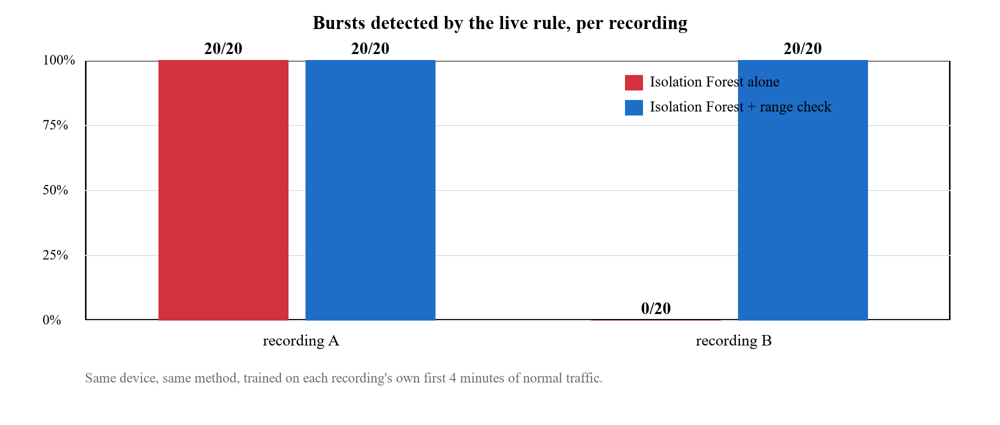
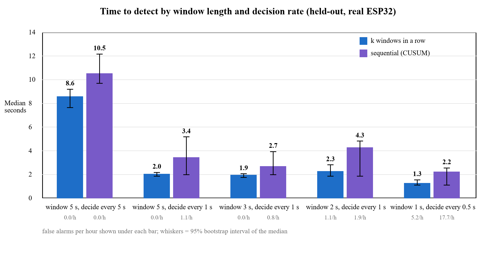
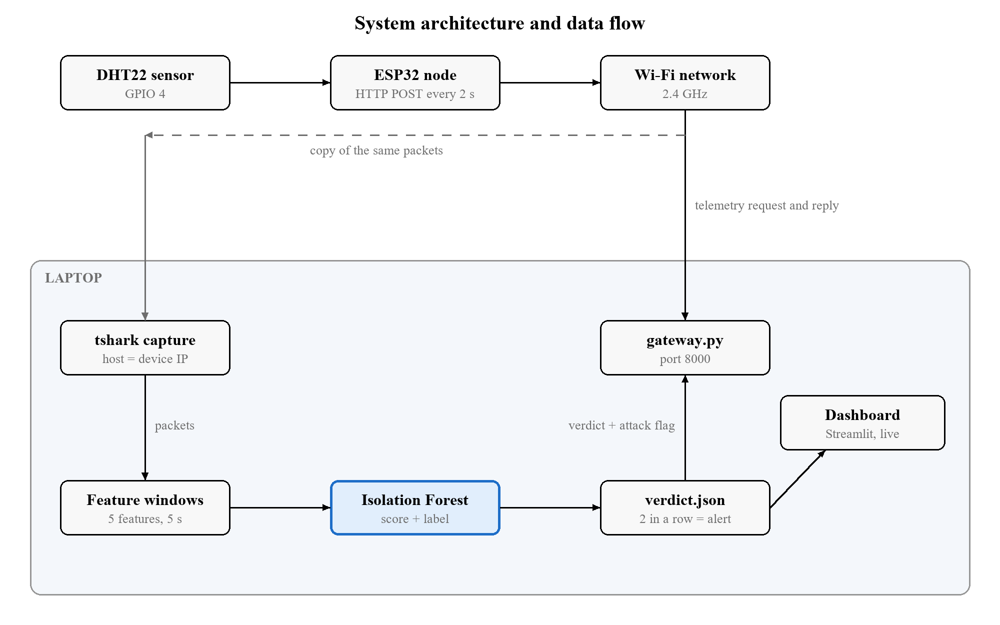
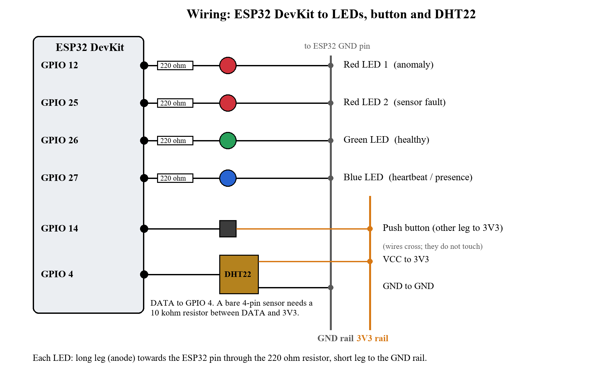
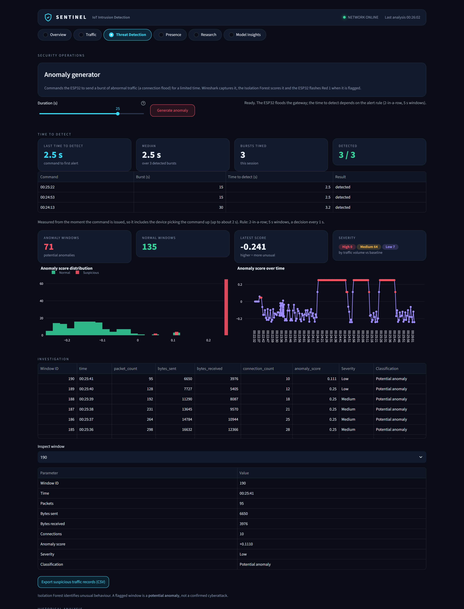
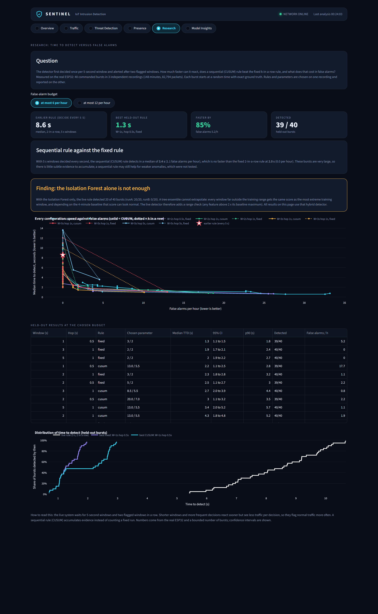

<div align="center">

# SENTINEL

**A lightweight IoT network anomaly detector, measured on real hardware.**

An ESP32 learns what normal Wi-Fi traffic looks like. When it stops looking normal, SENTINEL says so within about two seconds.

</div>

<p align="center">
  
</p>

---

## What it does

SENTINEL watches the network traffic of a small IoT device, learns its normal behaviour from about four minutes of data, and flags unusual behaviour as a **potential anomaly** on a live dashboard and on the device's own LEDs.

- **Real device, real packets.** An ESP32 sends data over Wi-Fi; Wireshark's `tshark` captures every packet; nothing is simulated unless the dashboard says so.
- **Learns only from normal data.** An Isolation Forest, plus a simple range check, needs no examples of attacks.
- **Measured, not claimed.** A built-in *Generate anomaly* button makes the device send a controlled burst at a known moment, so detection speed and false alarms can be measured exactly.
- **One board, two jobs.** The same ESP32 can also count nearby Wi-Fi devices (work in progress, see below).

## Results

Measured on one ESP32 in three recordings: two with 20 commanded bursts each, and one of 74 minutes of normal traffic only. Settings were chosen on one recording and reported on the other.

| Measurement | Result |
|---|---|
| Commanded bursts detected | **40 of 40** |
| Median time to detect | **2.0 s** (95% interval 1.9 to 2.2 s; 90% within 2.7 s) |
| Earlier setting (decision once per 5 s window) | 8.6 s |
| False alarms in 74 minutes of normal traffic | **0** (about 1.5 hours of normal traffic in all) |
| Isolation Forest alone | 20 of 40: it missed every burst in one recording |
| Sequential (CUSUM) rule against the fixed rule | no faster on these bursts (3.4 s against 2.0 s) |

<p align="center">
  
  
</p>

**A finding worth knowing.** On its own, the Isolation Forest caught all 20 bursts in the first recording and none in the second, with the same device and method. A tree model cannot extrapolate: anything far outside its training range gets the same score as the most extreme training window, and depending on the baseline that can look normal. SENTINEL therefore also flags any window where a feature exceeds twice its baseline maximum, which caught all 40 bursts with no extra false alarms.

These are results for **one device, one room and one kind of burst**. A flagged window is a potential anomaly, not a confirmed attack.

## How it works

<p align="center">
  
</p>

1. The **ESP32** posts a small message to the laptop gateway every 2 seconds and shows the verdict on its LEDs.
2. **tshark** captures the device's packets. Every second, the latest 5 seconds are summarised into five numbers: packets, bytes sent, bytes received, connections and duration.
3. The **model** scores each window against what it learned. Two flagged windows in a row raise an alert.
4. The **dashboard** shows the state, the packets, the scores and the measured time to detect for every burst.

## Quick start

**Requirements:** Windows 10 or 11, Python 3.10+, [Wireshark](https://www.wireshark.org/) with Npcap (keep the Npcap option ticked). For the hardware demo: an ESP32 DevKit and the [Arduino IDE](https://www.arduino.cc/en/software) with the ESP32 board package and the DHT sensor library.

```bash
pip install -r requirements.txt
```

### Option A: laptop only, no hardware

A simulated device stands in for the ESP32. The first start learns normal traffic for about four minutes.

```bash
start_simulated.bat
```

(or `python Lightweight_IoT_IDS/run_system.py --simulate`). Open <http://localhost:8501>, go to **Threat Detection** and press **Generate anomaly**.

### Option B: with an ESP32

1. Open `esp32_combined_node/esp32_combined_node.ino` in the Arduino IDE and edit three lines: `WIFI_SSID`, `WIFI_PASS` and `GATEWAY_IP` (your laptop's Wi-Fi address; run `ipconfig`). Use a **2.4 GHz** network: the ESP32 cannot join 5 GHz.
2. Choose the board *ESP32 Dev Module* and upload.
3. Run:

```bash
start.bat
```

The first start learns the device's normal traffic (about four minutes; do not press its button). Afterwards the dashboard shows **Normal** and the green LED lights. Add `--retrain` to learn again after changing the network.

Run `check_setup.bat` first if anything fails; it says how to fix what it finds.

### Wiring

<p align="center">
  
</p>

| Connection | ESP32 pin | Meaning |
|---|---|---|
| Red LED 1 | GPIO 12 | Flashes during an anomaly |
| Red LED 2 | GPIO 25 | DHT22 reading fails |
| Green LED | GPIO 26 | Gateway reachable, traffic normal |
| Blue LED | GPIO 27 | Heartbeat (fast blink while someone is present) |
| Push button to 3V3 | GPIO 14 | Hold to send a local test burst |
| DHT22 data | GPIO 4 | Temperature and humidity (optional; detection does not use it) |

Each LED goes through a 220 ohm resistor to ground.

## The dashboard

| Page | What it shows |
|---|---|
| **Overview** | Security state, live network map, packets per window, the anomaly generator |
| **Traffic** | Packet charts, protocol mix and the live Wireshark packet feed |
| **Threat Detection** | Anomaly generator, **time to detect** for every press, scores, investigation table, CSV export |
| **Presence** | Count of nearby devices on the network (work in progress) |
| **Research** | Speed against false alarms for every configuration; fixed rule against sequential rule |
| **Model Insights** | Algorithm, training data, live precision and recall, confusion matrix |

<p align="center">
  
  
</p>

A page-by-page explanation is in [`docs/SENTINEL_Dashboard_Guide.docx`](docs/SENTINEL_Dashboard_Guide.docx).

## The study and the dataset

`Lightweight_IoT_IDS/experiments/` contains the study behind the results: how fast can detection be, at what cost in false alarms, and does a sequential rule help?

| File | Purpose |
|---|---|
| `run_trials.py` | Records a run on the real ESP32 with commanded bursts at random times |
| `evaluate_rules.py` | Compares window lengths, decision intervals and rules (fixed *k*-in-a-row against CUSUM), held out across recordings, with bootstrap intervals |
| `make_figures.py` | Draws the figures |
| `export_dataset.py` | Turns recordings into the dataset below |
| `results/` | `results.json`, `summary.txt`, `curves.csv` and the figures |

**Dataset:** [`Lightweight_IoT_IDS/datasets/sentinel_windows.csv`](Lightweight_IoT_IDS/datasets/sentinel_windows.csv) holds 8,864 labelled windows from the three recordings (5-second windows, one per second, with the five features, the recording phase, and whether the window overlaps a commanded burst). The raw packet captures contain network identifiers and are not published.

## Counting nearby devices (work in progress)

The same ESP32 can listen passively to nearby Wi-Fi frames and count the devices on the network that are close. It keeps only a **hashed** value for each device, so no real address leaves the chip. In a first pilot (one room, two phones) the count was exact while devices stayed in place and slow to settle after they left. It counts devices that send data, **not people**, and its accuracy is still being measured. See [`docs/Presence_Counter_Tutorial.docx`](docs/Presence_Counter_Tutorial.docx).

## Repository layout

```
SENTINEL/
├── esp32_combined_node/        ESP32 firmware: anomaly detection and presence counting
├── Lightweight_IoT_IDS/
│   ├── gateway.py              receives the device's data, returns the verdict
│   ├── wireshark_ids.py        live capture, windows, scoring and alert rule
│   ├── train_esp32.py          learns the baseline
│   ├── presence_engine.py      presence counting rules
│   ├── run_system.py           one command: gateway, capture, detector, dashboard
│   ├── run_presence.py         presence demo launcher
│   ├── ai_engine/              features, model, range check, alert rules (fixed, CUSUM)
│   ├── dashboard/live.py       the Streamlit dashboard
│   ├── tools/                  simulators and the setup checker
│   ├── experiments/            the study, figures and results
│   └── datasets/               labelled windows
├── docs/                       setup guide, report, dashboard guide, slides, images
├── start.bat                   start with an ESP32
├── start_simulated.bat         start with a simulated device
└── check_setup.bat             check the installation
```

## Documentation

- [`docs/SENTINEL_Setup_Guide.docx`](docs/SENTINEL_Setup_Guide.docx): hardware, wiring, software, display and network requirements, run of show, troubleshooting
- [`docs/SENTINEL_Project_Report.docx`](docs/SENTINEL_Project_Report.docx): the full project report
- [`docs/SENTINEL_Dashboard_Guide.docx`](docs/SENTINEL_Dashboard_Guide.docx): every dashboard page and control
- [`docs/Presence_Counter_Tutorial.docx`](docs/Presence_Counter_Tutorial.docx): the presence counter
- [`docs/SENTINEL_Presentation.pptx`](docs/SENTINEL_Presentation.pptx): the lecture slides

## Limitations

- Tested on Windows, with one ESP32, one room and one kind of burst (a connection flood from the device itself). Port scans, slow attacks and replayed traffic were not tested.
- It reports unusual behaviour, not confirmed attacks. A legitimate change in behaviour looks unusual until the model learns again (about four minutes).
- The detector runs on the laptop, not on the ESP32.
- The prototype uses plain HTTP without authentication.
- The sequential rule was not faster on bursts this large; it was not tested on subtle anomalies.

## Author

**Aasritha Lakshmi Dakshinyam**, Amrita School of Computing, Amaravati. Built as a course project for *Introduction to Computer Networks* (22AIE204).

## License

Released under the [MIT License](LICENSE).
